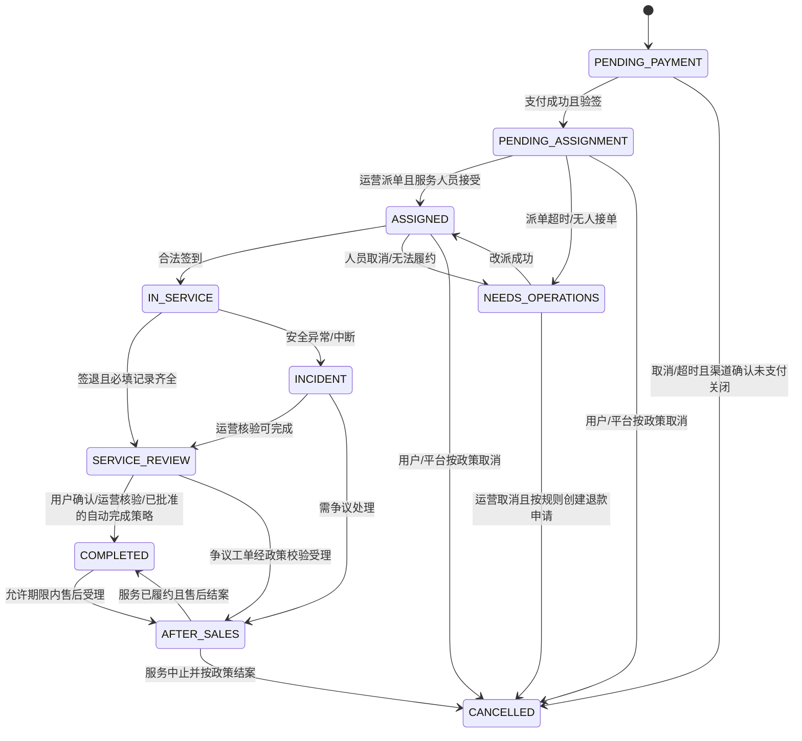

# 订单、支付、履约与售后状态机

> 状态：评审草案。订单、支付、履约、退款、售后各自维护状态；禁止用单一订单状态代替资金事实。

## 1. 订单状态

### 转移约束

| 事件 | 前置条件 | 写入/副作用 | 超时与失败处理 |
| --- | --- | --- | --- |
| 建单 | 用户有效、服务可售、时段有容量、报价未过期 | 事务内占位、写订单/快照/状态日志/幂等记录 | 任一写入失败回滚占位 |
| 支付成功 | 渠道验签通过，商户/订单号/币种/金额匹配 | 唯一渠道流水；支付单成功并写账务/事件；仅订单仍待支付且占位有效时转待派单 | 回调重复返回成功；通知遗漏由主动查单补偿；已关闭订单不复活，进入资金异常/退款流程 |
| 支付超时 | 当前仍待支付且超过截止时间 | 禁止继续预支付；查单/关单；渠道确认未支付关闭后才关闭订单并释放容量 | 渠道结果未知时保留占位并告警；已支付转待派单；已释放后晚到成功进入资金异常队列，不自动复活订单 |
| 派单/接受 | 订单待派单；喂养师审核有效、时段可服务 | 分配记录追加；条件更新确保单一有效分配 | 未接受超时返回待派单并告警；重试不得重复分配 |
| 签到 | 当前有效分配人、在允许窗口内、未签到 | 写履约事件及必要的位置校验摘要 | 弱网由幂等键重试；异常签到进入运营复核 |
| 签退 | 已签到；必填项目、记录已提交或明确失败原因 | 完结履约记录；进入待核验 | 不允许用前端字段直接标记订单完成 |
| 完成 | 待核验且无未结风险/售后，或履约完成且售后已结案 | 完成时间；按唯一来源生成待结算项（非实际打款），退款已计入应付净额 | 用户未反馈时使用已批准策略，否则运营队列处理；返回完成状态不重复生成结算 |
| 取消/退款 | 按角色和规则允许；金额经服务端计算 | 售后/退款单及不可变账务事件 | 渠道未知状态先查单，不能盲目重复退款 |

订单的 `CANCELLED` 表示履约被终止，不表示退款成功；`COMPLETED` 表示服务及核验已完成，不保证没有部分退款。退款是否在途、失败或完成由独立退款聚合展示。用户申请售后先创建工单；只有经政策校验的受理事件才能迁移订单状态。售后期间保留原履约事实，结算冻结由工单状态控制。

## 2. 独立状态枚举

- **支付：** `UNPAID → PROCESSING → PAID`；失败/取消保持可重试或关闭。支付回调是外部事实，渠道查询可用于对账补偿。
- **退款聚合：** `NONE / PARTIAL / FULL` 根据已成功退款累计金额计算；单笔退款还在途或未知时不得记为成功，也不得覆盖原始支付成功事实。
- **履约：** `NOT_STARTED → ACCEPTED → CHECKED_IN → IN_SERVICE → CHECKED_OUT → VERIFIED`，异常另记事件，不覆盖已发生事实。
- **退款：** `REQUESTED → APPROVED → PROCESSING → SUCCEEDED`；失败或结果未知进入 `EXCEPTION`，由查单确定是否可安全重试。
- **售后：** `OPEN → INVESTIGATING → RESOLVED/REJECTED`；进入调查后冻结相关结算，结论和证据追加保存。
- **结算：** `PENDING → APPROVED → PAYING → PAID` 或 `FAILED/ON_HOLD`；每一笔实付必须关联渠道/银行凭证，人工结算标注方式。

退款申请、审批、提交渠道、回调/查单确认、失败重试分别记录事件；占用可退额度时应包含成功及在途退款，未知结果继续占用，避免并发超退。已支付给喂养师的历史结算不回写成“未支付”，使用关联原结算的冲正、应收或经批准的抵扣记录处理后续退款。

## 3. 预约容量与锁定

按服务区域、服务类型、预约时段维护可售容量。建单事务使用条件扣减（`available > 0`）创建有过期时间的 reservation；跨多个时段应按固定顺序锁定并整体扣减，失败整体回滚。支付成功将 reservation 转为 confirmed；支付超时只有在渠道确认关闭且未支付后才能释放，释放使用状态条件更新确保仅执行一次。退款不一定意味着释放容量，已消费的服务时段不能重复售卖。

同一喂养师的跨区域/跨服务排班统一检查区间重叠，包括前后交通缓冲。接单时对喂养师日程加锁或使用等价的数据库串行化约束；仅保证“一单一人”不足以避免“一人同时间多单”。区域容量不能把同一名喂养师重复计入不同区域。改约先原子验证并占用新时段，再释放旧时段，任一失败保持旧预约不变；改派同步撤销前任授权并重新检查新人员日程。支付截止及异步重试由持久化任务推进，定时扫描作为补偿，不能只依赖客户端在线。容量和缓冲参数由运营确认。

## 4. 通用实现约束

- 状态变更使用条件更新/版本号；同事务写状态日志和 outbox 事件。
- 回调、重试任务和用户命令带幂等键；唯一约束保护渠道流水、有效分配和结算来源。
- 外部调用不纳入数据库长事务；用 outbox、重试、主动查询和人工队列实现最终一致。
- 所有时刻存 UTC，业务界面按服务区域时区显示；记录客户端时间仅作辅助证据。
- 定时任务必须可重入、可观测、可重放；告警需包含负责人和人工 Runbook。
