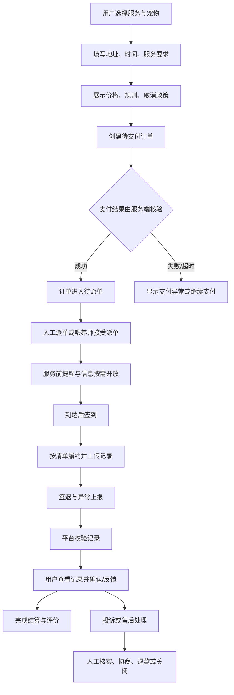
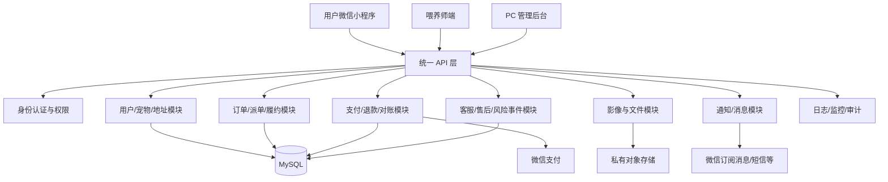

# 宠伴上门｜完整落地实施方案与 AI 提示词

> **文档版本：** V2.0  
> **更新日期：** 2026-10-12  
> **文档状态：** 立项与 MVP 实施基线  
> **产品定位：** 本地化宠物上门照护服务平台  
> **一期策略：** 用户微信小程序 + 喂养师端 + PC 管理后台  
> **二期策略：** 基于真实运营数据评估是否建设 iOS / Android App  
> **建议首发区域：** 单城市内 1 至 3 个相邻服务片区  
> **适用对象：** 创始团队、产品、设计、研发、测试、运营、客服及外部专业顾问  
> **重要说明：** 本文是产品、技术、运营与风控的实施基线，不构成法律、财税、保险或支付合规意见。正式上线前，应结合实际经营地、交易结构、平台规则及专业意见完成核验。

## 目录

- [阅读与使用方式](#阅读与使用方式)
- [核心结论](#核心结论)
- [1. 项目摘要与实施原则](#1-项目摘要与实施原则)
- [2. 产品范围与版本规划](#2-产品范围与版本规划)
- [3. 用户角色、权限与关键业务流程](#3-用户角色权限与关键业务流程)
- [4. 功能需求明细](#4-功能需求明细)
- [5. 服务 SOP 与异常处置](#5-服务-sop-与异常处置)
- [6. 定价、佣金与单位经济模型](#6-定价佣金与单位经济模型)
- [7. 技术架构建议](#7-技术架构建议)
- [8. 数据库设计建议](#8-数据库设计建议)
- [9. API 设计清单](#9-api-设计清单)
- [10. 隐私、安全、合规与资质核验](#10-隐私安全合规与资质核验)
- [11. 运营冷启动方案](#11-运营冷启动方案)
- [12. 项目排期、团队与交付物](#12-项目排期团队与交付物)
- [13. 测试策略与上线检查表](#13-测试策略与上线检查表)
- [14. AI 辅助开发总流程](#14-ai-辅助开发总流程)
- [15. 可直接复制使用的 AI 实施提示词库](#15-可直接复制使用的-ai-实施提示词库)
- [16. 推荐项目目录结构](#16-推荐项目目录结构)
- [17. 项目启动后第一周行动清单](#17-项目启动后第一周行动清单)
- [18. 最终建议](#18-最终建议)

## 阅读与使用方式

本文按“是什么 → 为什么 → 怎么做 → 怎么工程化”的顺序组织：

1. 第 1 至 3 章定义目标、范围、角色和业务闭环。
2. 第 4 至 6 章定义产品功能、服务 SOP 和商业模型。
3. 第 7 至 10 章定义技术、数据、接口、安全与合规基线。
4. 第 11 至 14 章定义冷启动、交付、测试和 AI 协作方式。
5. 第 15 章提供可直接复用的 AI 提示词，第 16 至 18 章给出目录、首周动作和最终决策建议。

使用时应将本文拆分为可版本化的项目产物，而不是把它当作一次性方案：PRD、状态机、权限矩阵、API 契约、数据库设计、测试计划、上线评审和运营复盘都应独立维护，并通过需求编号建立追踪关系。

## 核心结论

- **业务本质：** 平台出售的不是“代喂动作”，而是可信供给、可验证履约和可控风险。
- **MVP 路线：** 单城小片区、少量标准服务、人工审核、人工派单、系统留痕。
- **技术路线：** 模块化单体优先，订单、支付、履约分离建模，前端不掌握最终业务状态。
- **安全底线：** 入户凭证、精确地址、身份证明和家庭影像按敏感数据处理，最小采集、按单授权、全程审计、到期收回。
- **资金底线：** 先做订单级收款、退款、佣金计算和对账；余额、储值、自动分账和提现必须先核验产品能力与合规条件。
- **扩张条件：** 履约质量、复购、投诉趋势、供给稳定性和单笔贡献毛利同时达到阶段门槛后，再扩片区、扩城市或建设独立 App。

---

## 1. 项目摘要与实施原则

### 1.1 项目目标

建设“宠伴上门”宠物上门服务平台，连接养宠用户与经过审核、培训的喂养师（服务人员），为用户提供可预约、可追踪、有影像记录、可评价、可售后的宠物照护服务。

核心服务包括：

- 上门喂猫：添粮、换水、观察宠物状态。
- 上门遛狗：按约定时长遛狗，记录交接与过程。
- 环境清理：猫砂清理、食盆清洁、简单清洁。
- 临时照护：按约定频次进行短期上门看护。
- 增值服务：按平台规则提供梳理、植物浇水等可控附加项目。
- 特殊照护：喂药等项目应在明确服务边界、人员能力和风险告知后单独开放，不默认纳入基础服务。

### 1.2 MVP 的成功标准

一期不是追求功能数量，而是验证以下假设：

1. 用户愿意为可信赖的上门照护付费。
2. 平台能够在目标区域稳定招募并调度服务人员。
3. 服务人员能按时到达、按规范履约并提交合格记录。
4. 用户对服务质量和安全有信心，愿意复购。
5. 平台佣金能够覆盖支付、客服、获客、保险、退款与管理成本。

上线前应将目标值写入项目看板。以下仅为**建议的试运营观察线**，不是行业标准：

| 指标 | 建议试运营观察线 | 口径说明 |
| --- | --- | --- |
| 订单履约完成率 | ≥ 95% | 用户主动取消等场景应单独统计 |
| 准时到达率 | ≥ 90% | 按预约窗口及平台约定宽限时间计算 |
| 服务记录合格率 | ≥ 98% | 图片、服务项目、时间与日志符合要求 |
| 退款/投诉率 | 建立基线并持续下降 | 必须按原因、服务类型和服务人员分层分析 |
| 30 天复购率 | 按首发片区建立基线 | 结合服务频次、节假日和季节性判断 |
| 喂养师有效供给 | 覆盖高峰预约需求 | 看可接单时段和区域，不只看注册人数 |
| 单笔贡献毛利 | 经验证后趋向为正 | 扣除支付、补贴、客服、保险等可变成本 |

### 1.3 核心原则

- **先做服务闭环，再做复杂平台功能。**
- **先做单城、有限服务半径和人工兜底，再做全城自动派单。**
- **先做订单级结算与对账，再做钱包、会员等复杂资金产品。**
- **敏感信息最小化收集、按需展示、操作留痕、到期删除。**
- **安全优先于增长；涉及入户、钥匙、宠物行为和紧急情况的流程必须先设计。**
- **小程序和未来 App 共用业务 API、权限模型和数据模型，避免重复建设。**

### 1.4 项目假设与待验证问题

立项时应把“事实、假设、待确认事项”分开管理，避免团队把建议直接当成结论。

| 类别 | 当前假设 | 验证方式 | 决策影响 |
| --- | --- | --- | --- |
| 用户需求 | 用户愿意为可信、可追踪的上门照护付费 | 用户访谈、付费意向测试、首单转化 | 决定服务套餐和客单价 |
| 服务供给 | 目标片区能形成稳定的合格喂养师供给 | 招募漏斗、培训通过率、可接单时段 | 决定服务半径和可售时段 |
| 履约质量 | 标准 SOP 与影像记录能降低争议 | 模拟订单、灰度订单、投诉复盘 | 决定是否扩大订单量 |
| 单位经济 | 佣金可覆盖可变成本并逐步承担固定成本 | 按片区、渠道、服务类型核算 | 决定是否继续补贴或扩区 |
| 交易与结算 | 当前主体可使用所需支付、退款和结算能力 | 向支付机构和专业顾问核验 | 决定资金链路设计 |
| 风险保障 | 可获得适配上门宠物照护场景的保险或替代保障 | 核验承保范围、免责和理赔条件 | 决定服务边界和风险准备金 |

任何影响收款、入户、宠物安全或个人信息处理的未确认项，都应进入上线阻断清单，而不是留作上线后补充。

---

## 2. 产品范围与版本规划

### 2.1 一期 MVP 范围

| 模块 | 一期 P0 范围 | 明确暂缓 |
| --- | --- | --- |
| 用户小程序 | 微信登录、手机号绑定、宠物档案、地址、报价、下单、支付、订单、服务记录、评价、售后 | 社区、社交动态、直播 |
| 喂养师端 | 入驻申请、资料提交、审核状态、可服务时间、派单确认、履约打卡、服务记录、收入明细 | 复杂等级体系、自动排班优化 |
| PC 管理后台 | 用户、喂养师、订单、服务配置、派单、售后、基础报表、权限与审计 | 多层级加盟商、复杂 BI |
| 运营工具 | 人工派单、客服备注、异常订单处理、服务质量检查 | 全自动智能调度 |
| 资金能力 | 微信支付、服务端支付核验、退款、订单级佣金计算和对账 | 未经核验的余额、储值、任意转账 |
| 通知 | 订阅消息、站内状态、必要的短信或客服补充方案 | 自建即时通讯系统 |
| 文件 | 服务图片、必要的短视频、私有存储、授权访问 | 公共永久链接、默认长期保存 |

### 2.2 二期及以后

- 独立 iOS / Android App。
- 更完善的地图、服务范围与排班能力。
- 自动派单、路线优化、服务人员等级与培训体系。
- 会员订阅、套餐包、优惠活动。
- 宠物用品商城及第三方服务合作。
- 多城市、多运营团队与区域化权限。
- 智能客服、订单风险提示、服务记录质量辅助审核。

**二期启动条件建议：** 连续数月订单和复购达到预先设定目标，核心履约指标稳定，单位经济模型接近或达到正向，并且客服与运营流程可复制。不要仅以“注册用户多”作为启动 App 的依据。

### 2.3 MVP 非目标与变更控制

一期明确不解决以下问题：全国覆盖、复杂社交、商城、多级代理、全自动调度、自建即时通讯、复杂会员权益和独立 App。新增需求必须回答四个问题：

1. 是否直接影响“下单 → 支付 → 派单 → 履约 → 售后 → 对账”主链路？
2. 不做是否会阻断首发片区真实订单？
3. 是否引入新的资质、资金、安全或运维风险？
4. 能否通过人工 SOP 在灰度期替代？

只有阻断 P0 闭环或上线合规的需求可进入一期。其他需求进入候选池，并记录业务价值、实现成本、依赖和计划评审日期。

### 2.4 阶段决策门

| 阶段 | 进入条件 | 退出条件 | 关键决策 |
| --- | --- | --- | --- |
| 需求验证 | 首发片区和目标人群已明确 | 用户、供给、价格和风险假设有证据 | 是否进入产品设计 |
| 方案评审 | PRD、SOP、状态机、权限矩阵初稿完成 | P0 范围冻结，高风险依赖有负责人 | 是否进入开发 |
| 开发联调 | API、数据和测试策略通过评审 | 核心链路端到端通过，阻断缺陷清零 | 是否进入灰度 |
| 小范围灰度 | 支付、协议、培训、值班和应急预案就绪 | 指标稳定且重大事件可闭环 | 扩量、整改或停止 |
| 扩片区/扩城市 | 供给、复购、投诉和贡献毛利达到门槛 | 运营 SOP 可复制，系统容量可支撑 | 是否规模化 |

---

## 3. 用户角色、权限与关键业务流程

### 3.1 角色

1. **游客：** 浏览服务介绍、价格、规则；下单前登录。
2. **养宠用户：** 管理宠物、地址、预约、支付、查看服务记录、评价和申请售后。
3. **喂养师：** 维护申请资料、服务区域和时间，接受订单，按流程履约并查看收入明细。
4. **客服/运营：** 查看被授权的订单和必要资料，处理改约、投诉与异常。
5. **审核人员：** 审核喂养师身份、资料、培训和状态。
6. **财务人员：** 查看对账、退款和结算数据，不能无理由修改履约证据。
7. **管理员：** 管理角色权限、系统配置与审计；高风险操作需二次确认。

采用 RBAC（基于角色的权限控制）并结合数据范围控制。客服不应默认看到完整身份证号、完整门锁密码等敏感信息。

### 3.2 核心订单状态

建议将订单状态与支付状态、履约状态分开管理，避免一个状态字段承担所有含义。

**订单状态：**

`待支付 → 待确认/待派单 → 待服务 → 服务中 → 待用户确认/待平台核验 → 已完成`

异常分支：

- 用户取消
- 喂养师拒绝/取消
- 平台取消
- 改约处理中
- 售后处理中
- 退款中
- 已退款
- 争议冻结/人工处理

**支付状态：**
未支付、支付处理中、已支付、退款处理中、部分退款、已退款、支付异常待核验。

**履约状态：**
未开始、已接单、已签到、服务中、已签退、记录待审核、履约完成、异常中止。

所有状态变化必须由后端校验权限和前置条件，记录操作人、时间、来源、原因及关联请求号。不能仅凭前端传来的“支付成功”或“服务完成”字段改变状态。

### 3.3 核心流程



### 3.4 下单前必须明确的规则

- 服务项目、服务时长、包含与不包含的内容。
- 服务地址、可服务范围、预约时间及时间窗口。
- 宠物数量、体型、性格、攻击性或逃逸风险、特殊需求。
- 用户需提供的用品和进入方式。
- 价格、附加费、优惠规则、发票/凭证说明。
- 取消、改约、迟到、无法进入、宠物不配合等情况的处理方式。
- 服务记录形式、影像用途、保存期限及隐私规则。
- 紧急情况的联系顺序、授权范围与可能产生的费用。

### 3.5 敏感信息开放规则

| 信息 | 用户本人 | 已分配喂养师 | 客服/运营 | 审核/财务 | 开放时机 |
| --- | --- | --- | --- | --- | --- |
| 宠物照护说明 | 可查看/修改 | 仅查看当次订单必要内容 | 按工单需要查看 | 默认不可见 | 接单后至服务结束 |
| 精确地址 | 可查看/修改 | 仅查看已分配订单 | 异常处理时按需查看 | 默认不可见 | 临近履约时开放 |
| 入户凭证 | 可设置/撤销 | 短时解密查看，禁止复制传播 | 仅高权限应急查看 | 不可见 | 到达前有限时间至签退 |
| 身份审核材料 | 不适用 | 仅本人提交 | 默认脱敏 | 审核岗位按需查看 | 审核期间及必要留存期 |
| 家庭影像 | 查看本人订单 | 上传及查看本人履约内容 | 售后取证时按需查看 | 财务不可见 | 按订单授权和保留策略 |
| 账务与结算 | 查看本人支付/退款 | 查看本人收入明细 | 仅查看处理订单所需信息 | 财务按职责查看 | 订单及对账周期内 |

权限实现必须同时校验“角色、资源归属、订单关系、状态和授权时效”，不能只依赖页面隐藏或单一角色判断。

---

## 4. 功能需求明细

### 4.1 用户小程序

#### 首页

- 服务分类：上门喂猫、上门遛狗、基础清洁、临时看护。
- 服务范围提示：先选择城市/片区或填写地址后判断是否可服务。
- 服务说明、价格起点、服务流程和安全保障说明。
- 订单入口、优惠信息、常见问题、客服入口。
- 不应展示未经核验的“百分百安全”等绝对承诺。

#### 登录与个人资料

- 微信授权登录，按实际需要绑定手机号。
- 用户协议、隐私政策及必要的单独授权。
- 账号注销申请、隐私请求和客服入口。
- 只收集履约必需信息，避免默认收集无关个人信息。

#### 宠物档案

字段建议：

- 宠物昵称、类型、品种（可选）、年龄/出生年份（可选）。
- 体型、性格、是否怕生、是否有攻击或逃逸风险。
- 饮食与饮水要求、食物禁忌、猫砂/遛狗要求。
- 特殊照护说明、紧急联系人。
- 宠物照片（可选）。
- 用户确认自己有权提交这些信息，并可随时修改。

健康信息和喂药要求应采用最小化采集。平台不应将普通喂养服务宣传为兽医诊疗。

#### 地址与入户信息

- 地址簿、地图定位/手动选择、楼栋与门牌。
- 门禁方式及进入说明。
- 不建议在普通地址字段中直接存放长期有效的门锁密码。
- 入户凭证单独加密存储、按订单授权访问、记录查看行为，并在服务完成后按规则失效或删除。
- 对无法安全交接钥匙、门禁异常或用户无法联系的情况，设置明确的暂停服务流程。

#### 下单与支付

- 选择服务、宠物、地址、日期时间、服务时长和附加项。
- 价格明细：基础价、时长/距离附加费、优惠、应付金额。
- 下单前二次确认宠物风险、服务边界和取消规则。
- 订单创建采用幂等键，避免重复点击产生重复订单。
- 使用官方支付流程；后端验签并核验订单金额、商户、订单号和支付状态。
- 支付回调需幂等处理，不能只依赖客户端回调。

#### 订单中心

- 按状态筛选订单，展示订单号、服务项目、预约时间、服务人员、费用和状态。
- 提供符合规则的取消、改约、联系平台和售后入口。
- 订单详情展示关键状态时间线。
- 用户地址、入户信息仅在履约所需时向被分配的服务人员开放。

#### 服务记录

每次服务建议包含：

- 到达签到时间、离开签退时间。
- 必做项目清单及完成情况。
- 宠物状态的客观描述。
- 喂食/饮水/猫砂/遛狗等记录。
- 必要的前后对比照片或短视频。
- 异常事件、已采取的措施、联系用户的结果。
- 用户查看记录的时间及反馈。

照片和视频可能暴露室内环境、家庭物品或人员信息。界面应提示拍摄范围，禁止无关拍摄；访问链接应有时效和权限校验。

#### 评价与售后

- 评分、标签、文字评价。
- 投诉分类：迟到、服务未完成、宠物异常、入户问题、记录问题、收费争议等。
- 上传补充证据、查看处理进度。
- 退款申请、平台核实、处理结论和申诉入口。
- 对涉及人身安全、宠物受伤、疑似盗窃等重大事件设置升级处理流程，不仅作为普通客服工单。

### 4.2 喂养师端

#### 入驻申请

- 实名身份核验及必要资料提交。
- 联系方式、可服务区域、可服务时段、交通方式。
- 宠物照护经验、培训记录、相关资质（如业务确实需要）。
- 协议确认、隐私告知和资料用途说明。
- 审核状态：待提交、待审核、补充材料、通过、拒绝、暂停、封禁。
- 身份证等敏感资料加密、限制访问、按法律和业务必要期限保存。

#### 接单与排班

- 展示订单服务内容、预计时长、服务区域、报酬和关键风险提示。
- 接单前确认自己在预约时间可履约。
- 避免在接单大厅展示完整客户门牌、门锁密码等信息。
- 接单成功后再按权限逐步开放必要信息。
- MVP 可由运营人工派单，服务人员接受/拒绝并填写原因。
- 防止同一订单被重复接单；数据库层面保证订单分配唯一性。

#### 履约

- 查看当次订单任务清单。
- 到达后签到；定位只在必要时申请并清楚说明用途。
- 逐项完成服务并提交影像和文字记录。
- 离开前确认门窗、宠物状态、用品和入户交接要求。
- 签退并提交异常事件。
- 发生宠物攻击、走失、受伤、无法进入、用户失联等情况时，优先保证人和宠物安全，并按照应急流程联系用户与平台。

#### 收益与结算

- 展示已完成订单、订单收入、平台佣金、调整项、待结算与已结算金额。
- 提现申请、审核状态和失败原因。
- 不将“账面收益”直接等同于已到账金额。
- 资金结算流程需结合平台实际主体、服务关系、微信支付产品能力及适用监管要求确定；上线前应由支付服务商和专业顾问确认。

#### 消息沟通

- MVP 可先提供订单内留言/客服转达或有限消息能力。
- 屏蔽无关营销和骚扰，保留必要的订单沟通记录。
- 不建议一期自行建设复杂即时通讯基础设施。
- 对敏感入户信息设置展示时限，避免通过聊天反复传播密码。

### 4.3 PC 管理后台

#### 用户与服务人员管理

- 用户查询、账号状态、订单历史和售后记录。
- 服务人员审核、培训、服务区域、可服务状态、违规记录。
- 身份资料采用脱敏显示，只有授权岗位可查看必要原文。
- 账号封禁、解封、资料导出等操作需记录原因和操作日志。

#### 订单运营台

- 全量订单筛选、订单时间线、支付与退款状态。
- 人工派单、改派、取消、改约及异常标记。
- 仅在必要范围内查看入户说明。
- 超时订单、无人接单订单、未上传记录订单的告警。
- 重要操作二次确认，并记录操作前后值。

#### 服务与价格配置

- 服务类型、时长、基础价格、区域价格、附加项。
- 预约时间窗口、服务半径、可售日期、节假日策略。
- 价格变更应有生效时间、版本和操作记录，已支付订单保留原订单快照。

#### 售后与风险事件

- 工单创建、分类、优先级、责任人、处理时限、证据和结论。
- 重大事件升级、通知负责人、冻结相关结算（须有规则和权限）。
- 退款金额和原因审核。
- 处理结果、用户通知、申诉记录与复盘标签。

#### 财务与对账

- 订单应收、支付渠道实收、优惠承担方、退款、佣金、服务人员应结算金额。
- 日/月对账、差异列表、手工调整审批。
- 对账报表可导出，但导出权限要受控并记录审计。
- 退款、结算、佣金计算要有可追溯的账务明细，禁止直接覆盖历史金额。

#### 数据看板

- 订单量、支付订单量、履约完成率、取消率、退款率。
- 片区供需、接单率、准时率、服务记录合格率。
- 新客转化、复购率、客单价、获客成本。
- GMV、平台收入、服务人员收入、退款与可变成本。
- 所有指标定义统一，注明统计口径、时间范围和数据更新时间。

---

## 5. 服务 SOP 与异常处置

### 5.1 标准上门服务 SOP

1. **服务前：** 核对订单、宠物信息、用品、地址与用户特殊说明。
2. **出发前：**
    检查路线和预约窗口；若迟到风险明显，提前通知用户和平台。
3. **到达：**
    按约定方式联系用户；签到只用于服务核验，不用于超范围跟踪。
4. **入户：**
    按授权方式进入，不擅自进入未授权区域，不复制或转交钥匙/密码。
5. **确认宠物：**
    观察宠物状态，发现异常时先确保安全，不擅自做超出能力范围的处理。
6. **执行服务：** 按订单清单完成喂食、换水、清理、遛狗等。
7. **拍摄记录：**
    只拍摄履约所需范围，避免人脸、证件、财务文件和家庭隐私。
8. **离开前检查：**
    确认宠物处于约定安全状态、门窗和门锁按用户说明处理、用品归位。
9. **签退：** 提交服务日志、必要影像和异常记录。
10. **完成与复盘：**
    平台校验记录，用户查看并评价；异常订单转入客服处理。

### 5.2 异常情况处理矩阵

| 场景 | 服务人员立即动作 | 平台动作 | 后续处理 |
| --- | --- | --- | --- |
| 无法进入/门禁失效 | 联系用户，不擅自破门或尝试未授权方式 | 通知客服并记录时间和联系结果 | 按服务协议判断改约、取消及费用 |
| 用户失联 | 按约定联系人和升级顺序联系 | 记录联系过程并评估宠物风险 | 按事先授权与适用规则处理，不擅自作重大决定 |
| 宠物疑似受伤/严重异常 | 确保自身安全，及时联系用户和平台 | 启动紧急事件流程 | 依据授权和紧急程度联系专业机构或急救资源 |
| 宠物逃逸 | 不采取可能导致二次伤害的冒险行为，立即报告 | 通知用户和平台负责人，记录现场信息 | 启动走失预案并保留证据 |
| 服务人员受伤/遭攻击 | 立即脱离危险并寻求医疗或紧急帮助 | 暂停订单并升级事件 | 保险报案、事实核查与风险复盘 |
| 影像上传失败 | 保留本地待上传状态，不虚报完成 | 提供重试与客服提示 | 必要时人工核验，防止重复提交 |
| 支付成功但订单未更新 | 不重复扣款，不直接判定失败 | 服务端查单与对账修复 | 以支付渠道核验结果为准 |
| 用户投诉或疑似财物损失 | 不与用户争执，不删除记录 | 保全日志与影像，限制无关访问 | 按事件等级调查、通知相关方并依法处理 |

平台应为重大事件制定可联系到负责人的值班机制，并明确何时联系当地紧急服务、兽医或保险机构。不要在产品中承诺平台能够替代专业医疗或执法机构。

---

## 6. 定价、佣金与单位经济模型

### 6.1 定价设计

建议从少量标准套餐开始，例如：

- 基础上门喂猫：约定时长、喂食、换水、基础观察与影像反馈。
- 上门喂猫加强版：增加猫砂清理或额外宠物数量。
- 上门遛狗：按体型、时长、牵引要求和风险等级定价。
- 多宠物附加费、远距离附加费、节假日附加费。
- 喂药、复杂清洁等高风险/高要求服务先进行可行性评估，不应默认开放。

具体价格应通过首发片区竞品调查、用户访谈、服务人员收入预期和试运营数据确定，不建议在没有验证的情况下直接固定全国统一价。

### 6.2 单笔经济模型

定义：

- 用户实付 = 商品/服务标价 − 用户优惠 + 用户承担的附加费。
- 平台服务收入 = 按实际合同与交易结构确认的平台佣金/服务费。
- 单笔贡献毛利 = 平台服务收入 − 支付成本 − 获客摊销 −
    客服与售后可变成本 − 保险及补贴等可变成本。

示例（仅用于计算方式演示，不代表建议售价）：

| 项目 | 示例金额 |
| --- | ---: |
| 用户支付金额 | ¥100 |
| 平台按 20% 计佣的名义收入 | ¥20 |
| 支付、优惠补贴、保险、客服等可变成本 | ¥8 |
| 单笔贡献毛利（未扣固定成本） | ¥12 |

佣金比例不能单独决定盈利能力。若客单价低、服务距离长、获客成本高，20% 佣金仍可能亏损。建议按服务类型、片区和获客渠道分别计算。

### 6.3 资金和结算注意事项

- MVP 先实现订单级金额明细、退款、服务人员应结算金额和对账。
- 用户余额、储值、资金沉淀、自动分账与提现等功能可能涉及额外的支付产品和监管要求，应先向微信支付/服务商核实可用能力及平台资质。
- 不要把“平台内部记录余额”当作当然合规的资金账户。
- 所有支付通知验签、幂等处理；退款与结算有权限、审批、审计和对账。
- 佣金、优惠、退款和税务口径在上线前由财务及专业顾问确认。

### 6.4 商业决策看板

试运营阶段至少按“日期、片区、服务类型、渠道、喂养师”五个维度拆解指标，避免总量掩盖问题。

| 决策问题 | 必看指标 | 典型动作 |
| --- | --- | --- |
| 是否继续获客 | 首单转化、获客成本、首单履约率、30/60 天复购 | 调整渠道、优惠和服务套餐 |
| 是否增加供给 | 高峰缺口、接单率、平均派单时长、取消率 | 招募、排班、缩小或扩大服务区 |
| 是否调整价格 | 客单价、喂养师时薪、距离成本、贡献毛利 | 调整基础价、时长和附加费 |
| 是否扩片区 | 履约率、投诉率、供给密度、贡献毛利 | 灰度开放相邻片区 |
| 是否暂停某服务 | 风险事件率、售后成本、培训要求 | 收紧准入、重做 SOP 或下架 |

---

## 7. 技术架构建议

### 7.1 推荐的 MVP 技术方案

考虑快速交付、维护成本和未来 App 复用，建议使用模块化单体，而不是一期拆成大量微服务。

| 层次 | 推荐方案 | 说明 |
| --- | --- | --- |
| 用户端 | 微信原生小程序或团队已掌握的跨端框架 | 优先保证微信生态体验、支付和审核流程 |
| 喂养师端 | 同一小程序按角色分区，或独立服务人员小程序 | MVP 可复用组件与登录能力，权限必须由后端校验 |
| PC 管理后台 | Vue 3 + TypeScript + Element Plus，或团队成熟方案 | 适合表格、表单、权限和运营工作台 |
| API 服务 | Node.js + TypeScript + NestJS，或团队成熟框架 | 模块化、DTO 校验、统一异常和依赖注入 |
| 数据库 | MySQL 8.x 或兼容的托管关系型数据库 | 承载订单、支付、履约、权限等事务数据 |
| 缓存/队列 | 初期按需引入；出现异步任务和热点后增加 Redis/消息队列 | 避免为技术复杂度提前付费 |
| 文件存储 | 云对象存储 + 私有桶 + 短时签名 URL | 支持影像授权、生命周期和内容安全 |
| 地图 | 微信生态可用的地图和定位能力 | 明确授权用途并最小化定位采集 |
| 支付 | 微信支付官方商户能力 | 以实际主体资格和产品支持范围为准 |
| 部署 | 云托管或容器化服务 + 托管数据库 | 环境隔离、备份、监控和弹性扩容 |
| 可观测性 | 结构化日志、指标、链路标识、错误与对账告警 | 先建立定位和恢复能力 |

### 7.2 逻辑架构



### 7.3 工程化要求

- 开发、测试、生产环境分离，密钥不得提交到 Git。
- API 使用版本前缀，例如 `/api/v1`。
- 请求参数校验、统一错误码、接口限流与权限校验。
- 订单创建、支付回调、接单、签到签退、退款均实现幂等。
- 数据库迁移纳入版本控制，发布前备份并验证回滚策略。
- 定期备份数据库与对象存储元数据，开展恢复演练。
- 日志禁止记录明文密码、完整身份证号、支付密钥及不必要的敏感信息。
- 关键操作记录审计日志，重要配置变更可追溯。
- 对图片/视频进行文件类型、大小、访问权限和内容安全校验。
- 对上传失败、支付通知延迟、消息发送失败设置重试和告警。
- API 文档、部署手册、故障处理手册和数据字典纳入交付物。

### 7.4 非功能目标与容量基线

以下是 MVP 的建议初始目标，需在压测和灰度后修订：

| 类别 | 建议目标 | 验证方式 |
| --- | --- | --- |
| 可用性 | 核心下单、支付状态查询和履约接口月度可用性 ≥ 99.9% | 监控报表与故障记录 |
| 性能 | 常规读接口 P95 ≤ 500 ms；关键写接口 P95 ≤ 800 ms，不含第三方耗时 | 测试环境压测与生产监控 |
| 一致性 | 支付、退款、派单和状态迁移不重复、不丢失，可通过对账修复 | 幂等测试、并发测试、日对账 |
| 恢复能力 | 明确 RPO/RTO；建议初始 RPO ≤ 15 分钟、RTO ≤ 2 小时 | 备份恢复演练 |
| 安全 | 高危越权、明文密钥、公开敏感文件为零 | 上线安全评审 |
| 可追溯性 | 关键状态、资金变化、敏感数据访问均有审计记录 | 抽样审计和告警验证 |
| 发布质量 | P0/P1 自动化测试通过，阻断级缺陷为零 | CI 与上线检查表 |

### 7.5 关键技术决策

- **模块化单体优先：** 当前瓶颈是业务验证和履约治理，不是服务拆分；通过模块边界和事件接口为未来拆分留空间。
- **关系型数据库优先：** 订单、支付、履约和权限依赖事务与一致性，核心数据不应只存于缓存或文档数据库。
- **异步任务按需引入：** 通知、内容审核、对账和过期清理可异步化；支付状态与订单主状态仍需明确事务边界和补偿机制。
- **服务端为事实源：** 报价、权限、状态迁移、佣金和支付结果均以后端校验为准，客户端只负责交互和展示。
- **第三方能力可替换：** 地图、短信、对象存储、内容安全和支付接入通过适配层隔离，避免业务逻辑绑定单一 SDK。

---

## 8. 数据库设计建议

以下为逻辑表清单，正式开发时需根据字段规范、索引、数据量、隐私要求和支付方案完善 DDL。

| 表名建议 | 用途 | 关键字段或约束 |
| --- | --- | --- |
| `users` | 用户主表 | `id`、微信标识、手机号状态、账号状态、创建时间 |
| `user_profiles` | 用户资料 | 用户昵称等非敏感资料 |
| `pets` | 宠物档案 | `user_id`、宠物类型、照护说明、风险提示 |
| `user_addresses` | 地址簿 | 地址结构、默认地址、脱敏展示 |
| `access_credentials` | 入户凭证 | 加密内容、有效期、授权范围、访问审计；与普通地址分表 |
| `sitter_profiles` | 喂养师资料 | 用户 ID、审核状态、服务范围、可服务状态 |
| `sitter_verifications` | 审核材料 | 材料类型、审核人、结果、访问权限、保存期限 |
| `service_catalog` | 服务目录 | 服务类型、描述、状态、规则版本 |
| `service_price_versions` | 价格版本 | 服务 ID、区域、价格、有效期、版本号 |
| `orders` | 订单主表 | 订单号、用户、服务快照、预约时间、订单状态、金额快照 |
| `order_pets` | 订单与宠物关系 | 订单 ID、宠物 ID、照护说明快照 |
| `order_assignments` | 派单记录 | 订单 ID、服务人员、分配状态、操作人、时间；有效分配唯一 |
| `order_status_logs` | 状态历史 | 原状态、新状态、原因、操作人、时间、请求号 |
| `service_checkins` | 签到签退 | 订单 ID、事件类型、时间、必要的位置校验结果 |
| `service_logs` | 服务日志 | 订单 ID、项目、完成情况、描述、提交时间 |
| `media_assets` | 影像元数据 | 对象键、类型、大小、订单、访问策略、过期时间 |
| `payments` | 支付单 | 商户订单号、渠道流水号、金额、状态、幂等键 |
| `refunds` | 退款单 | 原支付单、退款金额、原因、渠道状态 |
| `ledger_entries` | 账务流水 | 业务类型、方向、金额、关联订单、不可变更流水 |
| `settlement_items` | 结算明细 | 订单、服务收入、佣金、调整项、结算状态 |
| `payout_requests` | 提现/付款申请 | 申请金额、审核状态、渠道结果；依合规方案启用 |
| `reviews` | 评价 | 订单 ID、评分、内容、审核状态 |
| `after_sales_tickets` | 售后工单 | 订单 ID、类别、优先级、处理状态、结论 |
| `risk_incidents` | 风险事件 | 类型、等级、时间线、负责人、证据引用 |
| `coupons` / `coupon_redemptions` | 优惠券 | 规则、有效期、使用状态、承担方 |
| `notifications` | 通知任务 | 接收方、模板、发送状态、重试次数 |
| `admin_users` / `roles` / `permissions` | 后台权限 | 角色、权限和数据范围映射 |
| `idempotency_keys` | 幂等请求 | 业务类型、主体、幂等键、响应摘要、过期时间 |
| `audit_logs` | 审计日志 | 操作人、动作、对象、时间、必要的前后值摘要 |

### 8.1 数据设计约束

- 主键建议使用不易被猜测的 ID；对外订单号独立生成。
- 金额使用整数分或精确十进制类型，禁止浮点数直接计算资金。
- 订单保存服务、价格、规则、地址必要信息的快照，避免配置变化影响历史订单。
- 支付回调使用渠道交易号和业务幂等键去重。
- 订单状态历史与账务明细采用追加记录思路，尽量不覆盖历史。
- 敏感字段独立存储并加密，密钥放在密钥管理服务中。
- 设定不同数据的保留期限；按业务、法律和争议处理需要制定删除/匿名化策略。
- 建立用户数据导出、纠错、注销和删除请求的处理流程，但需依法保留的记录按规定处理。

### 8.2 事务与一致性边界

- 创建订单时，应在同一事务内写入订单主表、价格/服务快照和初始状态日志。
- 接单或派单时，应使用条件更新、唯一约束或锁机制保证同一时刻只有一个有效分配。
- 支付通知处理时，应先验签和核对金额，再以渠道交易号与业务幂等键去重；订单状态与账务流水需保持可恢复的一致性。
- 文件上传采用“申请凭证 → 上传对象存储 → 服务端确认元数据”的两阶段流程，定期清理孤立文件。
- 跨第三方系统不追求分布式强事务，通过状态机、重试、主动查询、补偿任务和对账保证最终一致。

---

## 9. API 设计清单

统一约定：

- 前缀：`/api/v1`
- 认证：短时访问令牌/会话与服务端权限校验。
- 统一响应结构、错误码、请求追踪 ID。
- 对创建订单、支付、接单、退款等接口使用幂等键。
- 以下路径是设计示例，不是已经上线的接口。

### 9.1 用户、宠物与地址

| 方法 | 路径 | 用途 |
| --- | --- | --- |
| `POST` | `/auth/wechat-login` | 微信登录/会话建立 |
| `POST` | `/auth/bind-phone` | 绑定手机号 |
| `GET/PATCH` | `/users/me` | 查询/修改个人资料 |
| `GET/POST` | `/pets` | 查询/创建宠物 |
| `GET/PATCH/DELETE` | `/pets/:id` | 宠物资料维护 |
| `GET/POST` | `/addresses` | 地址簿查询/新增 |
| `PATCH/DELETE` | `/addresses/:id` | 修改/删除地址 |

### 9.2 服务与订单

| 方法 | 路径 | 用途 |
| --- | --- | --- |
| `GET` | `/services` | 查询可售服务 |
| `GET` | `/service-areas` | 查询服务区域 |
| `POST` | `/orders/quote` | 计算订单报价 |
| `POST` | `/orders` | 创建待支付订单 |
| `GET` | `/orders` | 查询本人订单 |
| `GET` | `/orders/:id` | 订单详情与权限过滤 |
| `POST` | `/orders/:id/cancel` | 申请取消 |
| `POST` | `/orders/:id/reschedule` | 申请改约 |
| `POST` | `/orders/:id/confirm` | 用户确认完成（若采用该机制） |
| `POST` | `/orders/:id/reviews` | 提交评价 |
| `POST` | `/orders/:id/after-sales` | 发起售后 |

### 9.3 喂养师端

| 方法 | 路径 | 用途 |
| --- | --- | --- |
| `POST` | `/sitters/applications` | 提交入驻申请 |
| `GET` | `/sitters/me/application` | 查看审核状态 |
| `PATCH` | `/sitters/me/availability` | 更新可服务时间/状态 |
| `GET` | `/sitter/orders/available` | 查询可接订单 |
| `POST` | `/sitter/orders/:id/accept` | 接受订单 |
| `POST` | `/sitter/orders/:id/reject` | 拒绝派单 |
| `POST` | `/sitter/orders/:id/check-in` | 签到 |
| `POST` | `/sitter/orders/:id/service-logs` | 提交服务记录 |
| `POST` | `/sitter/orders/:id/media` | 申请上传影像 |
| `POST` | `/sitter/orders/:id/check-out` | 签退 |
| `GET` | `/sitter/earnings` | 收益明细 |

### 9.4 支付、退款与管理后台

| 方法 | 路径 | 用途 |
| --- | --- | --- |
| `POST` | `/payments/wechat/prepay` | 创建支付参数 |
| `POST` | `/webhooks/wechat-pay` | 支付渠道通知，验签与幂等处理 |
| `GET` | `/payments/:id/status` | 服务端查询支付状态 |
| `POST` | `/orders/:id/refunds` | 申请/发起退款（需权限与规则） |
| `GET` | `/admin/orders` | 后台订单查询 |
| `POST` | `/admin/orders/:id/assign` | 人工派单 |
| `POST` | `/admin/sitters/:id/review` | 审核服务人员 |
| `GET` | `/admin/after-sales` | 售后工单列表 |
| `POST` | `/admin/after-sales/:id/resolve` | 售后处理 |
| `GET` | `/admin/reports/operations` | 运营指标 |
| `GET` | `/admin/reports/finance` | 财务对账报表 |

**API 安全重点：** 所有 `:id` 资源都必须验证当前主体是否有权访问，不能仅凭 ID 查询。服务人员只能访问分配给自己的订单；用户只能访问自己的宠物、地址、订单和服务记录；后台接口按岗位授权。

---

## 10. 隐私、安全、合规与资质核验

本节是上线前必须完成的工作清单，不构成正式法律意见。

### 10.1 需要核验的事项

1. 经营主体、营业执照经营范围和实际服务模式是否匹配。
2. 微信小程序类目、平台规则、认证要求和内容审核要求。
3. 微信支付商户资格、收款主体、退款与分账/结算方案是否适用。
4. 个人信息处理规则、隐私政策、用户授权和第三方 SDK 清单。
5. 身份证件、手机号、精确地址、定位、入户凭证和家庭影像的处理依据与保护措施。
6. 服务人员与平台、用户之间的合同关系及责任边界。
7. 保险产品的承保主体、责任范围、除外责任、理赔材料和报案时限。
8. 消费者权益、定价展示、取消/退款规则、发票与税务处理。
9. 影像和聊天记录保存期限、用户请求、投诉争议和依法留存的平衡。
10. 如服务涉及动物诊疗、药物操作或其他受监管活动，确认是否超出普通宠物照护范围。

### 10.2 最小安全基线

- 管理后台强密码与多因素认证（条件允许时）。
- 管理员、客服、审核、财务分权。
- 入户凭证独立加密，短时授权，访问审计。
- 影像采用私有存储、短时访问授权和到期清理。
- HTTPS、数据库访问控制、密钥轮换与环境隔离。
- 对登录、短信、下单、优惠、上传和退款接口设置限流与反滥用措施。
- 上传文件校验真实格式、大小和内容安全，不信任文件名。
- 支付回调验签、金额核对、重复通知幂等处理。
- 数据备份、恢复演练、事故响应和权限离职回收。
- 生产数据不得随意复制到开发测试环境；需要时脱敏处理。
- 记录访问和管理操作，但日志本身也不能泄露敏感数据。

### 10.3 保险与服务协议

保险不要只看"是否购买"，还应逐项确认：

- 是否覆盖上门服务人员在客户住宅内的责任。
- 是否覆盖宠物走失、受伤、第三方人身或财物损失。
- 是否覆盖遛狗期间的第三方责任及特定犬种/体型限制。
- 是否要求服务人员培训、牵引装备或特定操作流程。
- 免赔额、责任限额、除外责任和报案时限。
- 平台、服务人员和用户各自的责任如何约定。

上线前应由专业人士审核服务协议、用户协议、喂养师协议、隐私政策、影像授权和退款规则。不能通过协议简单排除依法不能排除的责任。

---

## 11. 运营冷启动方案

### 11.1 首发区域

- 选定一个城市内 1 至 3 个相邻片区。
- 先评估目标用户密度、养宠人群、交通时间、服务人员供给和竞品。
- 设置明确服务半径与预约时间窗口。
- 不建议初期接受超出服务范围的订单后再临时找人。

### 11.2 喂养师招募与培训

- 资料审核、身份核验、面谈/沟通、服务边界确认。
- 培训内容：宠物行为基础、入户规范、牵引安全、卫生、影像隐私、沟通、紧急事件、平台操作。
- 通过培训和模拟订单后开放接单。
- 设置试用期抽查、用户反馈回访、复训与暂停规则。
- 服务质量评估应结合证据和申诉，不只依据单次主观评分。

### 11.3 获客实验

渠道可包括本地宠物社群、小红书、抖音、宠物店合作、宠物医院/社区合作等，实际开展前遵守各平台规则并取得必要授权。

每个渠道使用独立来源标识，跟踪：

- 曝光、点击、咨询、注册、首单支付。
- 首单成本、首单履约成功率。
- 30 天/60 天复购、客单价、退款与投诉。
- 推荐来源、优惠券使用和真实贡献毛利。

### 11.4 信任建设

- 清晰展示服务人员审核流程和可验证的信息。
- 展示标准服务清单、真实服务记录示例（需获得授权并脱敏）。
- 说明平台如何处理迟到、无法进入、宠物异常和投诉。
- 不夸大背景调查、保险保障或“实时监控”等能力。
- 建立可触达的客服与紧急事件升级渠道。

---

## 12. 项目排期、团队与交付物

### 12.1 建议排期

3 个月目标可以作为紧凑型计划，但前提是需求范围受控、决策及时、支付与资质没有重大阻塞。建议按 12 周规划并设置验收门槛。

| 周期 | 主要工作 | 交付与验收 |
| --- | --- | --- |
| 第 1 至 2 周 | 用户访谈、价格调研、服务 SOP、业务边界、资质预核验 | MVP 范围、风险清单、PRD 初稿 |
| 第 3 周 | 用户流程、线框图、状态机、数据与权限设计 | 原型、流程图、状态定义、权限矩阵 |
| 第 4 周 | UI、技术架构、数据库/API 设计、环境搭建 | UI 规范、API 草案、开发环境、评审记录 |
| 第 5 至 7 周 | 登录、宠物/地址、服务目录、下单、订单、后台基础 | 核心链路可联调 |
| 第 8 至 9 周 | 支付、派单、履约打卡、服务记录、文件上传 | 主链路端到端测试通过 |
| 第 10 周 | 售后、退款、通知、审计、运营报表 | 异常链路可操作、可追溯 |
| 第 11 周 | 功能、安全、并发、支付对账、备份恢复演练 | 阻断缺陷清零、演练记录完成 |
| 第 12 周 | 小范围灰度、培训、上线审核、运营准备 | 上线检查表签字通过 |

微信审核、支付开通、主体材料准备等外部流程可能影响排期，应尽早启动，不应全部留到最后一周。

### 12.2 建议最小团队

- 产品/项目负责人：1 人。
- UI/UX：1 人，可阶段性投入。
- 小程序前端：1 至 2 人。
- 后端：1 至 2 人。
- 管理后台前端：1 人，可与小程序团队协作。
- 测试：1 人，可部分投入。
- 运营/客服负责人：至少 1 人，开发期间参与服务流程和验收。
- 法务/财税/保险/支付顾问：按需外部支持。

一人团队也可以验证需求，但需进一步缩小范围，例如先用人工运营和轻量管理工具跑通订单，再决定正式开发投入。

### 12.3 验收标准

- 用户可以完成登录、建宠物档案、选择服务、下单和支付。
- 重复点击或支付回调重放不会造成重复订单或重复记账。
- 管理员能完成审核、派单、异常订单处理与退款流程。
- 服务人员只能查看自己获分配订单的必要信息。
- 服务记录必须包含规定字段，影像无法上传时可明确提示并重试。
- 用户只能访问自己的订单与影像。
- 订单状态、支付状态和账务明细可追溯。
- 日常备份与恢复演练通过。
- 高风险权限、敏感数据访问和资金操作有审计记录。
- 服务协议、隐私政策、退款规则、应急预案与客服话术已准备并审核。

### 12.4 责任分工（RACI）

`A` 为最终负责，`R` 为执行，`C` 为参与评审，`I` 为知会。小团队可一人兼任多个角色，但责任不能缺位。

| 事项 | 产品/项目 | 技术 | 测试 | 运营/客服 | 财务/专业顾问 |
| --- | --- | --- | --- | --- | --- |
| MVP 范围与业务规则 | A/R | C | C | C | C |
| 架构、数据与权限 | C | A/R | C | I | C |
| 服务 SOP 与培训 | C | I | C | A/R | C |
| 支付、退款与对账 | C | R | C | I | A/C |
| 隐私、协议与资质 | C | C | I | C | A/R |
| 测试与上线评审 | C | R | A/R | C | C |
| 灰度运营与事故响应 | C | C | C | A/R | I |

### 12.5 必备交付物

- `01-PRD.md`：范围、需求编号、规则、验收条件和非目标。
- `02-workflows-state-machines.md`：订单、支付、履约、售后状态机。
- `03-wireframes.md`：页面地图、状态和交互说明。
- `04-architecture.md`：架构、模块边界、非功能目标和技术决策。
- `05-database-design.md` 与迁移脚本：数据模型、索引、事务和保留策略。
- `06-api-contract.md`：OpenAPI、权限、错误码、幂等和追踪约定。
- `13-test-plan.md`：需求追踪、自动化范围、测试证据和遗留风险。
- `14-release-review.md`：上线阻断项、例外项、负责人和复测结果。
- `15-deployment-operations.md`：部署、监控、告警、回滚和故障 Runbook。
- `16-go-to-market.md`：90 天冷启动、指标口径和扩张决策门。

---

## 13. 测试策略与上线检查表

### 13.1 必测场景

- 微信登录失败、手机号授权拒绝、会话过期。
- 同一用户重复提交订单、同一订单重复支付请求。
- 支付成功回调延迟、重复回调、支付成功但前端未收到结果。
- 两位服务人员同时接单、派单后取消、临时改派。
- 服务人员越权访问其他订单、用户访问他人宠物或影像。
- 定位拒绝、定位异常、签到时间异常。
- 上传大文件、错误格式、断网重试、重复上传。
- 用户取消、服务人员取消、平台取消、部分退款、全额退款。
- 用户投诉、服务记录缺失、重大风险事件升级。
- 数据库备份恢复、对象存储访问权限和过期清理。
- 管理员误操作、离职账号禁用、导出数据权限。
- 小程序审核、隐私授权弹窗和第三方 SDK 行为。

### 13.2 上线前检查表

- [ ] 经营主体、平台类目与业务资质已核验。
- [ ] 微信支付、退款、对账方案已在测试环境验证。
- [ ] 用户协议、隐私政策、服务人员协议和取消政策已审核。
- [ ] 喂养师身份审核与培训流程可执行。
- [ ] 价格、服务范围、预约窗口和附加费配置完成。
- [ ] 服务人员排班和客服值班安排完成。
- [ ] 宠物异常、走失、受伤、入户异常预案已演练。
- [ ] 影像、地址、入户凭证有访问权限与保存期限。
- [ ] 生产密钥、数据库权限、日志脱敏和备份已检查。
- [ ] 支付、订单、退款、结算对账流程已验证。
- [ ] 监控、告警、客服升级路径与负责人明确。
- [ ] 小范围灰度用户和服务人员已确定。
- [ ] 有回滚方案，且不会因回滚丢失支付/履约记录。

### 13.3 上线准入与退出标准

- **必须阻断上线：** 支付金额或状态可能错误、存在高危越权、入户凭证明文暴露、核心数据无法恢复、重大事件无人值守、必要协议或主体能力未核验。
- **允许带风险上线：** 仅限不影响资金、安全、隐私和核心履约的低风险问题，必须记录负责人、修复期限和临时措施。
- **灰度停止条件：** 发生未受控的重大安全事件、连续支付差错、履约质量显著低于门槛、客服无法在约定时限内处理异常。
- **复盘要求：** 每次发布和重大事件都要记录时间线、根因、影响、处置、改进项和验证结果，改进项进入任务系统跟踪。

---

## 14. AI 辅助开发总流程

建议不要一次性要求 AI “直接生成整个项目”，而应将工作拆成可验收的阶段：

1. **需求冻结：** PRD、角色权限、状态机、业务规则。
2. **产品原型：** 页面清单、关键流程、空状态和异常状态。
3. **技术设计：** 架构、数据库、API、支付与文件安全设计。
4. **项目骨架：** 仓库结构、环境配置、代码规范、CI。
5. **纵向切片开发：** 每次完成一条可测试业务链路，而不是按页面盲目堆代码。
6. **自动化测试：** 先测状态机、权限、金额计算和幂等。
7. **联调与验收：** 使用支付沙箱/测试环境和模拟数据。
8. **安全与合规复核：** 人工检查权限、敏感数据、支付和协议。
9. **灰度上线：** 小片区、小批服务人员、有限订单量。
10. **数据复盘：** 根据履约与经济模型决定是否扩张。

### 14.1 给 AI 的协作约束

- 先分析现有仓库和约定，不要未经确认重建项目。
- 先输出计划和文件清单，再修改代码。
- 每次只实现一个可验收的模块或端到端链路。
- 不得伪造微信支付成功、实名认证成功或保险生效状态。
- 不得把密钥、个人信息或生产数据写入示例代码。
- 不确定的合规事项标注“待专业核验”，不要编造结论。
- 每次修改后运行测试、类型检查、lint 和构建；报告实际结果。
- 对破坏性数据库迁移、删除数据、变更支付逻辑先征求确认。
- 生成代码时同时交付测试、配置说明、API 文档和必要的运维说明。

### 14.2 AI 输入上下文清单

每轮任务至少向 AI 提供或明确引用：当前仓库路径、技术栈、目标需求编号、允许修改的文件、相关状态机/API/数据表、验收标准、禁止事项和可执行验证命令。涉及外部平台时，还应给出当前主体、测试/生产环境边界以及已核验的官方能力。

### 14.3 AI 交付完成定义（Definition of Done）

AI 产出只有同时满足以下条件才算完成：

1. 需求编号、实现文件、API、数据表和测试用例可以追踪。
2. 正常、空、失败、无权限、重复请求和并发场景有明确处理。
3. 实际运行了适用的格式化、lint、类型检查、测试和构建命令，并如实报告结果。
4. 没有提交密钥、真实个人信息、生产数据或虚假的外部服务成功状态。
5. 数据库和接口变更包含兼容、迁移与回滚说明。
6. 未完成项、假设、风险和需要人工核验的事项被明确列出。

---

## 15. 可直接复制使用的 AI 实施提示词库

使用建议：先运行提示词 0，再按阶段依次执行。将每个阶段的输出保存到仓库的 `docs/` 目录，避免不同轮次的 AI 产出互相冲突。每次调用都应附带对应的已批准文档和需求编号，不要仅复制提示词正文。

### 提示词 0：项目总控与技术负责人

```text
你是“宠伴上门”项目的产品负责人、架构师、资深全栈工程师、测试负责人和安全审查者。

项目目标：
建设本地宠物上门服务平台。一期交付微信用户小程序、喂养师端和 PC 管理后台；二期才开发独立 iOS/Android App。核心服务为上门喂猫、上门遛狗、添粮换水、猫砂清理、短期上门看护。

默认技术建议：
- 用户端/喂养师端：优先采用团队熟悉且满足微信生态要求的方案；若没有既有约束，先比较微信原生小程序与跨端框架，再给出明确选择。
- PC 管理后台：Vue 3 + TypeScript。
- 后端：Node.js + TypeScript + NestJS。
- 数据库：MySQL 8.x 或托管兼容方案。
- 图片视频：私有对象存储、短时授权访问。
- 架构：模块化单体，先不拆微服务。
- 支付：使用官方支付能力，所有支付结果由服务端核验。

工作规则：
1. 不要一开始就生成大量代码。先检查仓库、技术约束和已有文件。
2. 先给出分阶段计划、文件清单、依赖关系和验收标准。
3. 将业务规则、订单状态机、权限矩阵、异常处理和数据安全放在核心位置。
4. 所有资金、身份、地址、入户凭证和家庭影像相关设计都必须考虑权限、审计、保存期限和失败处理。
5. 不要把前端传来的支付成功字段作为真实支付凭证；必须设计服务端验签、查单、幂等和对账。
6. 不得编造资质、保险保障或法律结论。无法确认的事项列为“上线前待专业核验”。
7. 不得将密钥或真实个人信息写入代码、日志、截图或提交记录。
8. 每个开发阶段都要有测试、验收条件和回滚考虑。
9. 每轮先说明准备修改什么，完成后列出文件变化、测试命令和真实执行结果。
10. 未经确认，不执行删除数据、不可逆迁移或生产资金操作。

第一步只做：
A. 盘点当前项目/仓库；
B. 识别缺失信息和高风险假设；
C. 输出 MVP 范围、模块依赖、阶段计划、建议目录结构和验收清单；
D. 不修改文件、不生成业务代码，等待确认。
```

### 提示词 1：生成完整 PRD

```text
请为“宠伴上门”编写可交付给产品、设计、开发、测试和运营团队的 MVP PRD。

产品范围：
1. 用户微信小程序；
2. 喂养师端；
3. PC 管理后台；
4. 支付、派单、履约记录、售后、对账和基础运营指标。

请按以下章节输出：
- 背景、目标、非目标和成功指标；
- 用户角色与权限；
- 用户旅程和端到端业务流程；
- 页面清单及页面状态；
- 功能需求，使用唯一需求编号（如 FR-ORDER-001）；
- 业务规则、价格规则、取消/改约/退款规则；
- 订单状态机、支付状态机、履约状态机；
- 异常流程与人工兜底；
- 非功能需求：安全、隐私、可用性、性能、可维护性；
- 埋点事件及指标口径；
- 验收标准和测试场景；
- 上线前依赖与待确认问题。

必须重点覆盖：宠物档案、服务地址、敏感入户信息、服务人员审核、人工派单、签到签退、照片/视频反馈、宠物异常事件、投诉退款、订单级结算与对账。

要求：
- MVP 优先，不做无关社交和复杂会员功能；
- 每条需求有优先级 P0/P1/P2、业务规则和验收条件；
- 区分已确定事实、建议方案和待确认事项；
- 不要虚构法律结论、支付资质或保险承诺；
- 输出 Markdown，建议保存为 docs/01-PRD.md；
- 最后给出需求追踪矩阵，关联需求、页面、API、数据表和测试用例。
```

### 提示词 2：生成业务流程与状态机

```text
请为“宠伴上门”设计可实现、可测试的业务流程和状态机。

必须输出：
1. 用户下单到完成/售后的主流程；
2. 喂养师申请、审核、暂停和恢复流程；
3. 人工派单、接受、拒绝、改派流程；
4. 签到、服务记录、签退和用户确认流程；
5. 支付、退款和对账流程；
6. 宠物受伤、走失、无法入户、用户失联、服务人员受伤等风险事件流程。

每个流程请给出 Mermaid 图、状态定义、允许的状态转换、触发角色、前置条件、失败处理和审计要求。

订单、支付、履约必须采用相互独立的状态机。明确哪些动作由用户、服务人员、后台人员、支付回调触发；明确哪些动作需要后端事务、幂等键、并发控制和人工审批。

输出 docs/02-workflows-state-machines.md。不要写业务代码。
```

### 提示词 3：生成页面地图与低保真原型说明

```text
请为“宠伴上门”MVP 设计页面地图和低保真原型规格。

分为：
A. 用户微信小程序；
B. 喂养师端；
C. PC 管理后台。

每个页面输出：
- 页面目标；
- 入口与跳转；
- 页面模块和字段；
- 主操作与次操作；
- 加载、空数据、失败、无权限、网络中断状态；
- 表单校验；
- 敏感数据显示规则；
- 对应需求编号与 API。

用户端重点：首页、服务详情、宠物档案、地址簿、下单确认、支付结果、订单列表、订单详情、服务记录、评价、售后、个人中心。

喂养师端重点：入驻申请、审核状态、接单大厅、订单详情、签到、服务清单、影像上传、签退、收益明细。

后台重点：登录、工作台、用户、喂养师审核、订单与派单、服务配置、售后工单、风险事件、财务对账、权限与审计。

设计风格：清新、可信、温和、易读；不要过度卡通化。不得用未经核实的认证徽章或安全承诺误导用户。

输出 docs/03-wireframes.md，并提供可交给 Figma 或原型工具的逐页描述。暂不生成生产代码。
```

### 提示词 4：生成 UI 视觉规范与设计稿提示词

```text
你是资深移动端产品设计师。请基于“宠伴上门”的 PRD 和页面地图，制定一套可落地的 UI 设计规范。

品牌关键词：温暖、可信、干净、专业、对宠物友好。
请输出：
- 品牌色、辅助色、中性色、状态色及使用规则；
- 字体层级、间距、圆角、阴影、图标规范；
- 按钮、输入框、卡片、标签、订单状态、上传控件、弹窗、空状态组件；
- 小程序首页、服务详情、下单确认、订单详情、服务记录、喂养师接单页、后台订单表格的布局说明；
- 无障碍与可读性建议；
- 加载、空、错误、成功、警告状态；
- 隐私敏感信息如何遮罩。

视觉要求：简洁、可信，不要使用过多渐变和装饰。价格、服务范围、取消规则、风险提示要清楚。不要伪造“官方认证”“保险已保障”等状态。

请先输出设计规范和逐页说明，再生成设计稿。若绘图工具不能输出可编辑组件，应同时给出可由开发实现的尺寸、组件和状态说明。
```

### 提示词 5：技术架构与项目脚手架

```text
请为“宠伴上门”设计并搭建可维护的 MVP 工程架构。

开始前先检查现有仓库，遵守既有技术栈和代码规范；如果仓库为空，再提出并确认目录结构。

目标：
- 用户小程序；
- 喂养师端；
- PC 管理后台；
- Node.js + TypeScript 后端；
- MySQL；
- 私有对象存储；
- 官方支付接口；
- 自动化测试与部署说明。

要求：
1. 优先模块化单体，禁止无理由引入微服务。
2. 明确模块边界：auth、users、pets、addresses、sitters、services、orders、dispatch、fulfillment、media、payments、refunds、settlement、after-sales、notifications、admin、audit。
3. 统一配置、日志、异常处理、DTO 校验、API 版本、权限守卫。
4. 使用环境变量/密钥管理，不把密钥写入仓库。
5. 数据库迁移有版本号和回滚说明。
6. 提供 lint、类型检查、单元测试和构建命令。
7. 生成 README、.env.example、架构说明、开发启动指南。
8. 不接入真实支付、不使用真实个人数据、不宣称外部服务已成功开通。

先输出目录结构、依赖选择和实现计划，确认后再创建文件。完成后报告实际运行过的命令和结果。
```

### 提示词 6：数据库 ER 图与 DDL

```text
请根据已确认的“宠伴上门”PRD和状态机设计数据库。

交付：
- ER 关系图（Mermaid）；
- 表清单与字段数据字典；
- MySQL DDL 和索引；
- 主键、唯一键、外键/逻辑关联策略；
- 金额、时间、时区、状态和软删除约定；
- 订单服务快照、价格快照和状态日志设计；
- 支付通知幂等、退款、结算和对账设计；
- 地址、身份证明、入户凭证、照片视频元数据的安全设计；
- 数据保留、删除、匿名化与备份恢复建议。

重点：
- 金额使用整数分或精确 DECIMAL，不用浮点数；
- 支付、订单、接单、退款的重复请求必须可安全处理；
- 同一订单不能被并发重复分配；
- 敏感入户凭证不能和普通地址明文混放；
- 历史订单必须保留当时的价格与服务规则快照；
- 关键状态与账务变更可审计；
- 不要把身份证号码、门锁密码等敏感值放入示例数据。

先做设计评审，不要直接修改生产数据库。输出 docs/05-database-design.md 和 migrations 草案。
```

### 提示词 7：API 契约与权限矩阵

```text
请根据已确认的 PRD、数据库和状态机，生成“宠伴上门” API 契约。

要求：
- 使用 REST 风格，统一 `/api/v1`；
- 为每个接口定义方法、路径、角色、用途、请求/响应 Schema、错误码、权限、幂等策略；
- 区分用户、喂养师、客服、审核、财务、管理员权限；
- 防止越权访问：不能只凭资源 ID 查询；
- 对订单创建、支付、接单、签到签退、退款和结算定义幂等行为；
- 支付通知必须验签、核对商户和金额，并能处理重复/乱序通知；
- 上传采用受控的上传凭证和私有对象存储；
- 说明分页、筛选、排序、限流、日志和请求追踪 ID；
- 提供 OpenAPI 规范或可转换为 OpenAPI 的结构。

输出 docs/06-api-contract.md。先检查接口是否覆盖所有 P0 需求，给出需求追踪矩阵；不要声称接口已接通真实微信服务。
```

### 提示词 8：实现用户小程序

```text
请根据已批准的 PRD、UI 规范和 API 契约，实现“宠伴上门”用户微信小程序。

实现顺序：
1. 登录与会话；
2. 首页和服务目录；
3. 宠物档案；
4. 地址簿；
5. 报价与下单；
6. 支付流程；
7. 订单列表与详情；
8. 服务记录；
9. 评价与售后；
10. 个人中心与隐私入口。

要求：
- 先确认实际小程序技术栈和目录，不要重建仓库；
- 页面必须覆盖加载、空、错误、无权限、网络失败等状态；
- 价格由后端报价结果为准，前端只展示；
- 不把支付成功回调当作最终凭证；
- 不在客户端硬编码密钥；
- 地址和入户凭证最小化展示；
- 上传图片需校验类型和大小，并支持失败重试；
- 组件可复用，关键流程有测试；
- 每完成一个业务切片，运行类型检查、lint、测试和构建。

先输出实现计划和文件变更列表，随后分批实施。输出 docs/07-mini-program.md。
```

### 提示词 9：实现喂养师端

```text
请根据已批准的需求和 API 契约，实现“宠伴上门”喂养师端。

功能：
- 入驻申请和资料补充；
- 审核状态；
- 服务区域与可服务时段；
- 可接订单/派单通知；
- 接受、拒绝和取消规则；
- 订单详情与必要信息授权；
- 签到、履约清单、图片/视频记录、异常事件、签退；
- 收益明细和结算状态。

安全要求：
- 仅允许访问本人资料及分配给自己的订单；
- 未接单前不显示完整门牌或入户凭证；
- 订单完成后按策略收回敏感信息访问权限；
- 定位只在必要场景请求并说明用途；
- 不允许客户端直接修改佣金、收入或订单最终状态；
- 服务记录、签到和签退都要由后端校验；
- 异常事件提供清晰的升级入口。

先检查仓库和 API 契约，列出实施计划。每个模块完成后运行测试并报告结果。输出 docs/08-sitter-app.md。
```

### 提示词 10：实现 PC 管理后台

```text
请实现“宠伴上门”PC 管理后台，优先使用 Vue 3 + TypeScript 及项目已选定的 UI 组件库。

MVP 模块：
- 登录与角色权限；
- 用户管理；
- 喂养师资料审核；
- 服务与价格配置；
- 订单查询、人工派单、改派与取消；
- 服务记录检查；
- 售后工单和风险事件；
- 退款与订单级财务对账；
- 基础运营指标；
- 操作审计。

要求：
- 菜单和按钮权限仅作前端体验控制，后端必须再次授权；
- 身份、地址和入户信息默认脱敏；
- 高风险操作需要二次确认和原因；
- 资金相关字段不可随意手工覆盖，调整必须有审批和流水；
- 表格需支持分页、筛选、空状态、加载失败和导出权限控制；
- 所有操作显示清楚的成功/失败反馈；
- 不生成虚假统计数据冒充生产指标。

先检查现有代码与接口，输出页面清单和开发计划；分模块实现并测试。输出 docs/09-admin-console.md。
```

### 提示词 11：微信支付、退款与对账专项

```text
请对“宠伴上门”的支付、退款、佣金与结算模块进行专项设计和实现评审。

先根据当前实际商户主体、支付产品和官方文档确认可用能力；如果条件未知，列出待确认清单，不要假设一定支持自动分账或提现。

必须覆盖：
- 服务端创建支付单；
- 支付回调验签、商户/订单/金额核对；
- 重复和乱序通知处理；
- 主动查单与支付状态修复；
- 退款申请、审核、渠道退款结果；
- 优惠承担方、平台佣金、服务人员应结算金额；
- 订单级账务明细与日/月对账；
- 异常差异告警、人工复核和审计；
- 幂等键、事务边界、并发和重试策略；
- 测试环境与生产密钥隔离。

禁止：
- 只凭客户端告诉服务器“支付成功”就完成订单；
- 重复回调导致重复记账；
- 在没有核实产品资质的情况下承诺自动分账/提现；
- 将内部余额包装成未经确认的资金账户。

先输出时序图、状态机、风险清单和测试用例，再提出实现方案。不得调用真实资金接口。
```

### 提示词 12：文件上传、影像隐私与入户信息安全

```text
请对“宠伴上门”的图片/视频上传、家庭影像、用户地址和入户凭证设计安全方案并检查实现。

要求：
1. 对象存储默认私有，使用短时授权 URL；
2. 服务端校验上传权限、文件类型、大小、订单归属和文件内容；
3. 文件元数据关联订单和上传人，但避免在日志中暴露敏感内容；
4. 用户只能查看自己的订单影像，服务人员只能上传/查看获授权订单；
5. 入户凭证单独加密、按需授权、记录访问时间和访问者；
6. 服务结束后收回访问权限，按保留政策删除或匿名化；
7. 避免拍摄无关家庭区域、人员、证件和财物；
8. 上传失败可重试，重复上传不产生重复业务记录；
9. 检查过期 URL、越权访问、路径猜测、恶意文件和大文件攻击；
10. 提供数据泄露应急流程和审计报表。

请先进行威胁建模，列出资产、攻击面、风险和缓解措施，再检查代码与测试。输出 docs/12-media-privacy-security.md。
```

### 提示词 13：测试计划与自动化测试

```text
你是“宠伴上门”测试负责人。请基于 PRD、状态机、API 契约和代码，制定并执行 MVP 测试计划。

测试层次：
- 单元测试；
- API 集成测试；
- 前端组件/页面测试；
- 端到端关键路径测试；
- 权限与越权测试；
- 支付/退款模拟测试；
- 并发接单与幂等测试；
- 文件上传和访问权限测试；
- 回归测试；
- 备份恢复与故障演练。

重点测试：
1. 重复创建订单和重复支付通知；
2. 两人同时接单；
3. 用户/服务人员越权访问；
4. 支付成功但前端超时；
5. 影像上传失败；
6. 签到后异常中止；
7. 用户投诉与退款；
8. 敏感数据脱敏、授权和过期；
9. 管理员高风险操作审计；
10. 数据库迁移和恢复。

请将每个测试用例关联需求编号，说明前置条件、步骤、预期结果和严重等级。运行测试时只报告真实执行结果；未执行的测试标记为“未执行”。输出 docs/13-test-plan.md。
```

### 提示词 14：安全审查与上线评审

```text
请作为独立安全与上线评审人员，审查“宠伴上门”项目，不要直接假设开发实现正确。

检查：
- 身份认证、会话和权限；
- IDOR/BOLA 越权访问；
- 用户、喂养师、后台角色隔离；
- 支付验签、金额核对、幂等、退款与结算；
- SQL 注入、XSS、CSRF（按架构适用性）、文件上传；
- 地址、身份证资料、入户凭证和影像泄露；
- 日志、备份、密钥和生产环境配置；
- 依赖漏洞、错误处理和限流；
- 隐私政策、授权、数据保留与删除流程；
- 保险、服务协议、紧急事件和客服流程是否存在待确认项。

输出：
1. 风险分级（Critical/High/Medium/Low）；
2. 证据与受影响文件/接口；
3. 修复建议和复测方法；
4. 上线阻断项；
5. 上线后观察项；
6. 是否建议上线及理由。

没有证据的项目标记为“未验证”，不能标记为通过。输出 docs/14-release-review.md。
```

### 提示词 15：部署、运维与故障恢复

```text
请为“宠伴上门”制定测试环境和生产环境的部署、监控、备份、恢复与回滚方案。

要求：
- 环境隔离、密钥管理、最小权限；
- 数据库迁移和发布前备份；
- 应用健康检查、日志、错误追踪和告警；
- 支付通知失败、订单状态不一致、影像上传失败、消息失败的监控；
- 数据库与对象存储备份策略；
- 定期恢复演练；
- 灰度发布、版本回滚和数据库兼容性策略；
- 事故分级、值班责任人和沟通流程；
- 费用预算与资源扩容条件；
- 生产数据脱敏和访问审计。

请给出按步骤执行的部署清单、回滚检查表、常见故障 Runbook 和恢复演练脚本草案。涉及真实生产环境的破坏性操作必须先请求确认。输出 docs/15-deployment-operations.md。
```

### 提示词 16：运营与商业模型

```text
请为“宠伴上门”制定首发城市/片区的 90 天冷启动运营计划。

必须包含：
- 首发片区选择标准；
- 用户访谈与竞品价格调查；
- 喂养师招募、审核、培训、排班和质量管理；
- 服务 SOP 与重大风险事件演练；
- 小红书、抖音、社群、宠物店等渠道的合规获客实验；
- 服务套餐、附加费、节假日定价和取消规则；
- 客服排班与售后时限；
- 漏斗指标、复购、投诉、履约和单位经济模型；
- 周度复盘模板；
- 停止、调整或扩张的决策门槛。

请区分事实、假设和待验证事项，不要编造市场规模或竞品数据。所有目标值都要标注为“建议初始目标”，并说明如何根据实际数据调整。输出 docs/16-go-to-market.md。
```

### 提示词 17：生成未来 App 二期规划

```text
请根据“宠伴上门”一期实际实现和运营数据，制定二期独立 iOS/Android App 规划。

先评估：
- 小程序的留存、复购、用户反馈和使用限制；
- 是否有必要开发独立 App；
- App 的目标用户与独有价值；
- 现有后端 API、身份体系、支付、推送和文件能力的复用情况；
- 是否需要拆分服务或调整架构。

输出：
- App 与小程序功能差异矩阵；
- iOS/Android 技术方案比较；
- 推送、离线消息、深度链接、权限和审核要求；
- 迁移与兼容策略；
- 成本、排期、风险与验收标准；
- 继续使用小程序、开发 App 或暂缓的决策建议。

不得仅因技术兴趣建议开发 App；必须结合真实订单、复购、留存和单位经济数据。输出 docs/17-app-phase2.md。
```

---

## 16. 推荐项目目录结构

可按团队和框架调整，不必为了匹配目录而重建已有仓库。

```text
pet-companion/
├── apps/
│   ├── miniapp-customer/       # 用户小程序
│   ├── miniapp-sitter/         # 喂养师端（也可与用户端合并）
│   ├── admin-web/              # PC 管理后台
│   └── api-server/             # Node.js API
├── packages/
│   ├── api-client/             # API 客户端
│   ├── shared-types/           # 共享类型
│   ├── validation/             # 可复用校验
│   └── ui-tokens/              # 设计变量
├── database/
│   ├── migrations/
│   ├── seeds/
│   └── diagrams/
├── docs/
│   ├── 01-PRD.md
│   ├── 02-workflows-state-machines.md
│   ├── 03-wireframes.md
│   ├── 04-architecture.md
│   ├── 05-database-design.md
│   ├── 06-api-contract.md
│   ├── 07-mini-program.md
│   ├── 08-sitter-app.md
│   ├── 09-admin-console.md
│   ├── 12-media-privacy-security.md
│   ├── 13-test-plan.md
│   ├── 14-release-review.md
│   ├── 15-deployment-operations.md
│   ├── 16-go-to-market.md
│   └── 17-app-phase2.md
├── infra/
├── scripts/
├── .env.example
├── README.md
└── CONTRIBUTING.md
```

---

## 17. 项目启动后第一周行动清单

### 产品与业务

- [ ] 选定首发城市和 1 至 3 个服务片区。
- [ ] 完成至少 10 位目标养宠用户和 5 位潜在喂养师访谈，记录真实痛点与付费意愿。
- [ ] 明确服务套餐、服务时长、服务半径、预约窗口和取消规则。
- [ ] 明确重大事件的联系人、处理时限和人工兜底。
- [ ] 将 MVP 需求标记为 P0/P1/P2，冻结一期非目标。

### 资质与资金

- [ ] 核验经营主体、微信小程序类目和认证材料。
- [ ] 与支付服务商确认收款、退款、佣金结算/分账的实际可行方案。
- [ ] 询价并核验保险条款，不以营销宣传代替承保确认。
- [ ] 安排服务协议、隐私政策、喂养师协议和退款政策审查。

### 技术与交付

- [ ] 建立代码仓库、分支策略、Issue 和版本管理。
- [ ] 确认技术栈、环境、数据库和文件存储方案。
- [ ] 先完成订单状态机、权限矩阵、数据库和 API 评审。
- [ ] 建立测试数据与支付模拟方案。
- [ ] 设定每周验收演示和变更控制机制。

---

## 18. 最终建议

“宠伴上门”真正的壁垒不是页面数量，而是**可信服务供给、稳定履约、隐私保护、异常处理和可持续的单位经济模型**。

一期建议坚持：

1. 一个城市、有限片区、少量标准服务。
2. 人工审核与人工派单优先，系统记录完整。
3. 不做复杂钱包和未经确认的自动分账。
4. 订单、支付、履约分开建模并可审计。
5. 对地址、入户凭证、家庭影像实施严格访问控制。
6. 先用真实履约数据证明复购和盈利，再决定扩城或开发 App。

只要能把“下单 → 支付 → 派单 → 安全入户 → 服务记录 → 异常处理 → 退款/结算 → 复购”这条链路做可靠，就具备进入下一阶段的基础。
